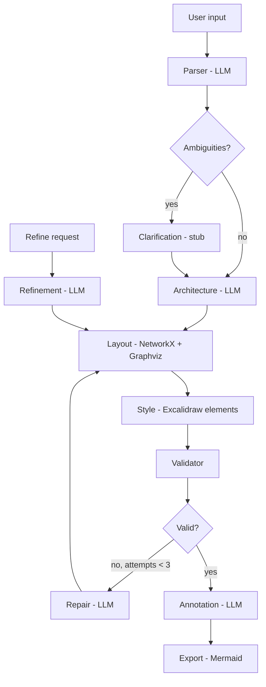

# ArchiGen AI

Describe a software system in plain English and get an editable [Excalidraw](https://excalidraw.com) architecture diagram plus a short Architecture Decision Record (ADR).

This is a **learning project**. I built it to understand LangGraph (stateful, multi-step LLM workflows), streaming responses over SSE, and how to combine LLMs with deterministic code. Text-to-diagram tools already exist (Excalidraw and Mermaid both have AI features), so this isn't trying to compete with them. The interesting part for me was the design decisions, listed below along with what's still broken.

## How it works

A request runs through a LangGraph state machine. The LLM only produces *logical* structure (components, layers, edges). Everything spatial is computed by normal code.



| Node | LLM? | What it does |
| :--- | :---: | :--- |
| Parser | yes | Free text → `ParsedIntent` (components, relationships, ambiguities) |
| Clarification | no | **Stub.** Routing exists but the node doesn't pause for answers yet |
| Architecture | yes | `ParsedIntent` → `ComponentGraph` (ids, layers, protocols) |
| Layout | no | Graphviz `dot` computes x/y; falls back to a simple grid if Graphviz fails |
| Style | no | Maps the positioned graph to Excalidraw rectangles, text and bound arrows |
| Validator | no | Checks arrow bindings, text containers and rectangle overlaps |
| Repair | yes | Given validator errors, fixes the graph. Max 3 attempts |
| Annotation | yes | Writes 2–3 sticky notes and an ADR. Note placement is deterministic |
| Export | no | Generates Mermaid code |
| Refinement | yes | Applies an edit instruction to an existing diagram (`/refine`) |

Progress is streamed to the React UI over Server-Sent Events (one event per finished node). Auth is Clerk (JWT verified on the backend), with a per-user daily limit of 5 requests stored in SQLite.

## Design decisions

- **LLM for semantics, code for geometry.** Models are unreliable at x/y coordinates, so the LLM never produces them (the annotation prompt doesn't even see them).
- **Typed contracts between stages.** Each stage has a Pydantic model (`ParsedIntent` → `ComponentGraph` → `PositionedGraph` → `ExcalidrawPayload`), and structured output keeps the LLM inside those schemas.
- **Validate, then repair with a cap.** A deterministic validator runs first; a failing graph goes to the Repair node, at most 3 times. If it still fails, the API returns an explicit error event.
- **SSE over WebSockets/polling.** Data only flows server → client. The client uses `fetch` + `ReadableStream` instead of `EventSource` because it needs a POST body and an `Authorization` header.
- **SQLite for the rate limit.** Zero infrastructure for a small project. It doesn't scale horizontally and isn't durable on ephemeral hosts.

## Known limitations

Being upfront about these:

- **Clarification is a stub.** `/clarify` and `/export` are placeholder endpoints (exports happen client-side).
- **Layer ordering isn't enforced.** The `rank=same` grouping in `agents/layout.py` is currently ineffective due to an inverted condition, so Graphviz ranks nodes from edge direction only.
- **Refinement is lossy.** It rebuilds a graph from the rendered Excalidraw JSON (which doesn't carry layers/protocols), and manual canvas edits are discarded on re-layout.
- **Repair can't see geometry.** The Repair node gets error text, not coordinates, so it's much better at fixing bad edge ids than overlaps.
- **No automated tests and no evaluation.** I haven't measured how often the first pass succeeds or how often repair helps, so I make no numeric claims. `testing/prompts.md` has manual test prompts.
- **State is in memory.** The LangGraph `MemorySaver` checkpointer is per-process and never evicted.
- **Rate limiting is basic.** The check and increment aren't atomic, a failed run still uses a credit, and SQLite resets if the host disk is ephemeral.
- **Diagram quality is simple.** Arrows are straight lines and long node names aren't wrapped.

## Running locally

Requirements: Python 3.11+, Node 20+, [Graphviz](https://graphviz.org/download/) installed and on `PATH`, a [Groq](https://console.groq.com) API key, and a [Clerk](https://clerk.com) application.

```bash
# backend/.env
GROQ_API_KEY=...
CLERK_ISSUER=https://<your-clerk-domain>

cd backend
pip install -r requirements.txt
uvicorn main:app --reload        # http://localhost:8000
```

```bash
# frontend/.env
VITE_CLERK_PUBLISHABLE_KEY=...
VITE_BACKEND_URL=http://localhost:8000

cd frontend
npm install
npm run dev                      # http://localhost:3000
```

There is also a `docker-compose.yml` for running both services (it uses the Vite dev server, so it's for development, not deployment). The SQLite file (`backend/archigen.db`) is created on first start and is git-ignored.

## Stack

FastAPI · LangGraph · LangChain + Groq (`llama-3.3-70b-versatile`) · NetworkX + Graphviz · Pydantic · aiosqlite · React 19 · Vite · Tailwind · Excalidraw · Zod · Clerk

## What I'd do next

1. Fix the layer grouping and add unit tests for layout, validator and Mermaid export.
2. Persist the `ComponentGraph` and make refinement apply patches to it instead of re-deriving it from the rendered diagram.
3. Implement clarification with LangGraph `interrupt` and a durable checkpointer.
4. Write a small eval script (first-pass validity, repair rate, latency) so claims are measured.
5. Make the rate limit atomic.
